<div align="center">


# Mano Studio

**Computer architecture, from notation to execution.**

An offline-first desktop environment for Morris Mano's *Computer System Architecture*.<br>
Write register-transfer language, translate it into assembly, inspect a computer in motion,<br>
and explore digital logic through interactive educational tools.

[](#download)
[](#quick-start)
[](#architecture)
[](#a-workspace-that-adapts)
[](LICENSE)
[](#release-status)

[**Download**](#download) · [Explore the workspace](#explore-the-workspace) · [Academic core](#academic-core) · [Quick start](#quick-start) · [Documentation](#documentation)

<a href="docs/assets/screenshots/editor.png">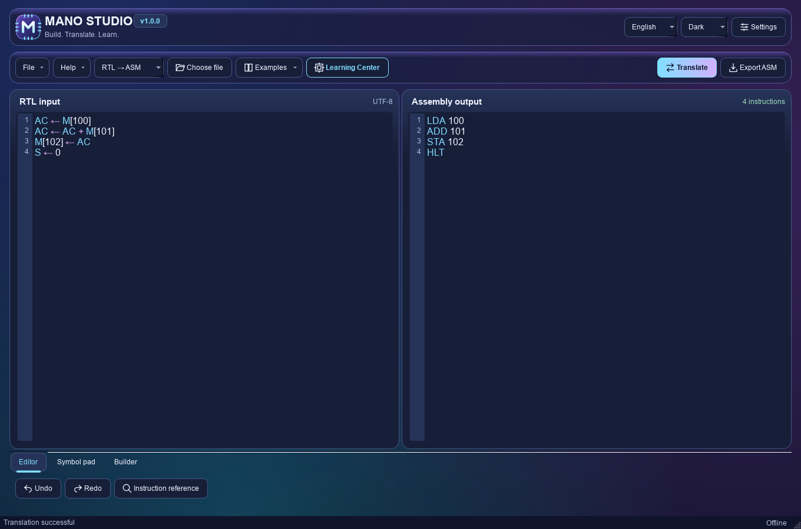</a>

<sub>Actual Mano Studio 1.0.0 candidate screenshot · Windows CI, dark theme</sub>

</div>

---

## Download

**Windows desktop & laptop · Intel / AMD 64-bit (x64) · Windows 10/11 target**

Choose **Setup** for a normal installation or **Portable** to run without installing. Both contain the same application for their respective version, with the required Python and Qt runtime bundled.

> **Release review — 28 November 2026:** No approved public download is available yet. The earlier frozen Stable and Beta candidates passed their own regression and hosted installer checks, but the current notice-corrected replacement candidates are different exact source revisions and are undergoing fresh verification. Follow [Stable PR #70](https://github.com/mohammadrezamie/mano-studio/pull/70) and [Beta PR #71](https://github.com/mohammadrezamie/mano-studio/pull/71) for current evidence. Earlier review artifacts and draft assets are superseded for this verification cycle; do not download or redistribute them. New Setup and Portable links will appear here only after the replacement candidates pass their exact-source checks and release approval.

### Download table

| Version | Architecture | Setup — recommended | Portable | Release status |
| :--- | :---: | :---: | :---: | :--- |
| **1.0.0 Stable** | Windows x64 | Not publicly available | Not publicly available | Private draft · [replacement verification](https://github.com/mohammadrezamie/mano-studio/pull/70) |
| **1.1.0-beta.1 Beta** | Windows x64 | Not publicly available | Not publicly available | Private prerelease draft · [replacement verification](https://github.com/mohammadrezamie/mano-studio/pull/71) |

<sub>These are release targets, not download links. Permanent installers and Portable ZIPs will be listed only after the exact replacement artifacts pass full regression, packaging, installation, provenance, security and redistribution review.</sub>

[](https://github.com/mohammadrezamie/mano-studio/releases)

### Setup or Portable?

| **Setup (.exe)** | **Portable (.zip)** |
| --- | --- |
| Recommended for everyday use and classroom demonstrations. | Useful for temporary use or carrying the program to another compatible PC. |
| Run the installer; optionally create a desktop shortcut. Launch from Start Menu. | Extract the complete ZIP and run `ManoStudio.exe` from the extracted folder. |
| Uninstall through Windows settings. | Remove the extracted program folder; preferences may remain in the Windows user profile. |

<details>
<summary>System compatibility, verification and other platforms</summary>

Check **Settings → System → About → System type** before downloading.

| Platform | Availability |
| --- | --- |
| Windows 11 x64 / Windows 10 x64 | Target platforms. Earlier candidates passed hosted Windows installer profiles; the current notice-corrected replacements are under fresh verification. Independent clean physical/VM Windows 10/11 compatibility and interactive acceptance remain unverified. Use a security-supported Windows edition. |
| Windows x86 (32-bit) | Not available; current Qt/PySide6 dependencies lack official x86 Windows wheels. |
| Windows ARM64 | No verified native package or emulation support yet. |
| Linux / macOS | Source development only with compatible dependencies; no official installer. |
| Android / iOS | Not supported by this desktop application. |

Additional architecture feasibility is tracked in [#54](https://github.com/mohammadrezamie/mano-studio/issues/54). The standalone Python translator remains independent of desktop GUI dependencies.

Verify the matching SHA-256 checksum when a package becomes available on the official Releases page. Neither candidate is Authenticode-signed. Applicable security, redistribution and independent native acceptance reviews remain open. The private drafts still require refresh with the new exact-byte replacement packages; historical assets must remain excluded from public promotion. GitHub/Sigstore post-build verification of the earlier frozen candidates passed; it is not Authenticode.

</details>

---

## Built for learning by doing

Mano Studio brings the textbook's concepts into one cohesive desktop application. Its primary purpose is to convert supported Mano RTL notation to assembly. The additional workspaces let students explore the relationships between instructions, registers, memory, digital circuits and the underlying computer architecture.

| Workspace | Highlights |
| --- | --- |
| **RTL Studio** | Text editor, guided instruction builder, symbol pad, diagnostics and plain-text assembly export |
| **Basic Computer** | Assembly, instruction execution, register and memory inspection, debugger and execution traces |
| **Digital Logic Lab** | Interactive gates, truth tables, Boolean equations, sequential circuits, Karnaugh maps and state design |
| **Learning Center** | Searchable exercises and links to interactive models across 13 indexed textbook chapters |

The curriculum coverage is partial and explicitly tracked; indexing every chapter does not mean implementing every topic in the book.

## Explore the workspace

<table>
<tr>
<td width="50%" valign="top">
<a href="docs/assets/screenshots/builder.png">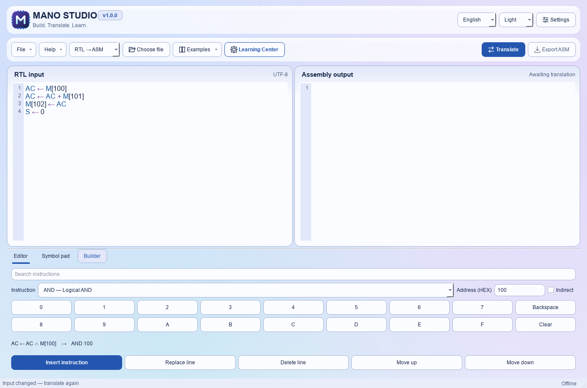</a>
<br><strong>01 · Guided RTL authoring</strong><br>
<sub>Build supported instructions using visual controls and hexadecimal entry.</sub>
</td>
<td width="50%" valign="top">
<a href="docs/assets/screenshots/computer.png">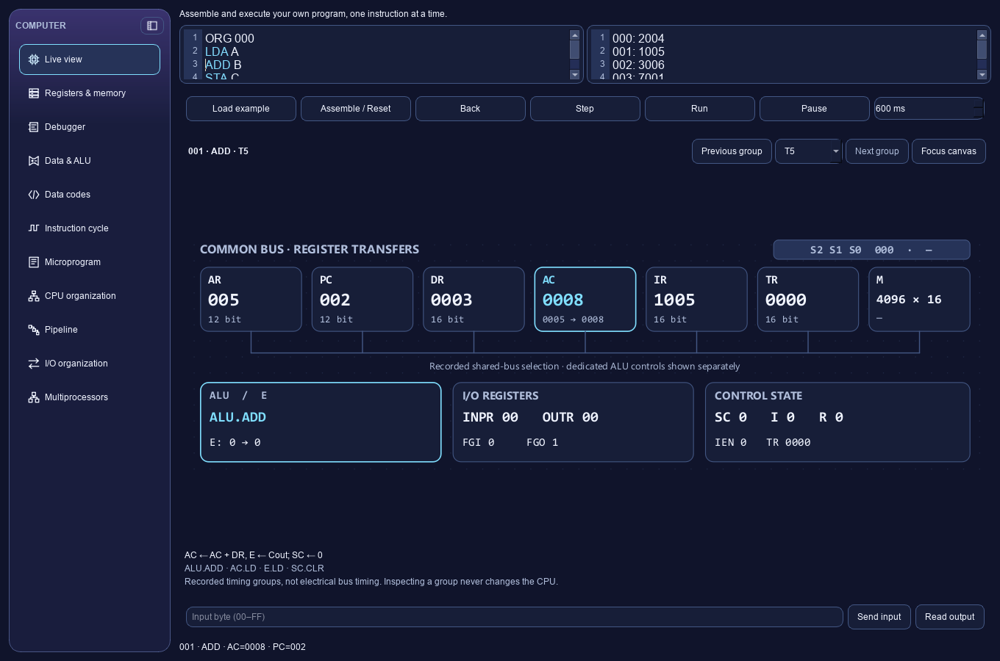</a>
<br><strong>02 · Basic Computer</strong><br>
<sub>Assemble and execute programs while inspecting the machine state.</sub>
</td>
</tr>
<tr>
<td valign="top">
<a href="docs/assets/screenshots/logic.png">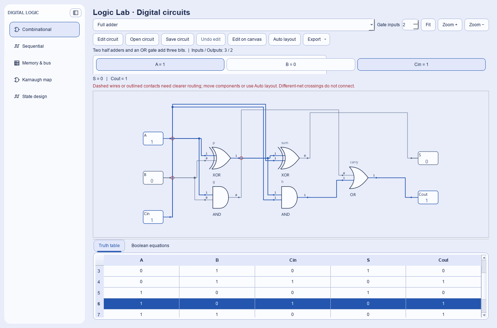</a>
<br><strong>03 · Digital Logic Lab</strong><br>
<sub>Explore circuit connections, truth tables and Boolean expressions.</sub>
</td>
<td valign="top">
<a href="docs/assets/screenshots/debugger.png">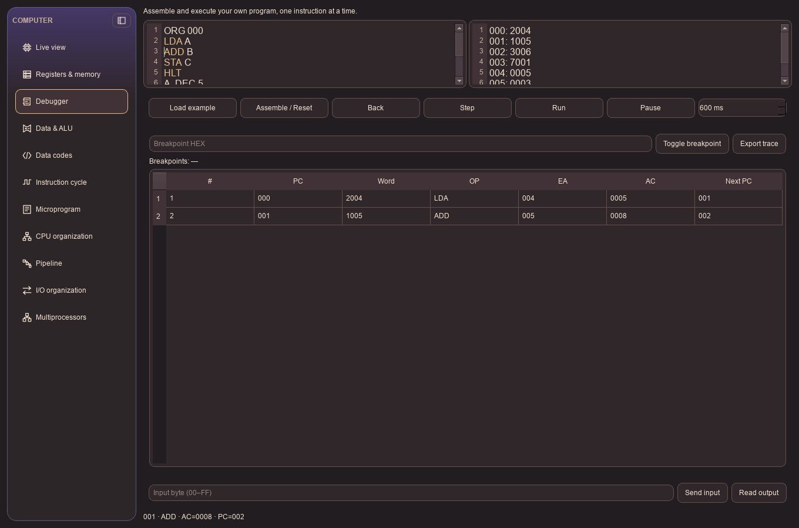</a>
<br><strong>04 · Debugger</strong><br>
<sub>Review instruction execution and trace the effects of a program.</sub>
</td>
</tr>
<tr>
<td valign="top">
<a href="docs/assets/screenshots/learning.png">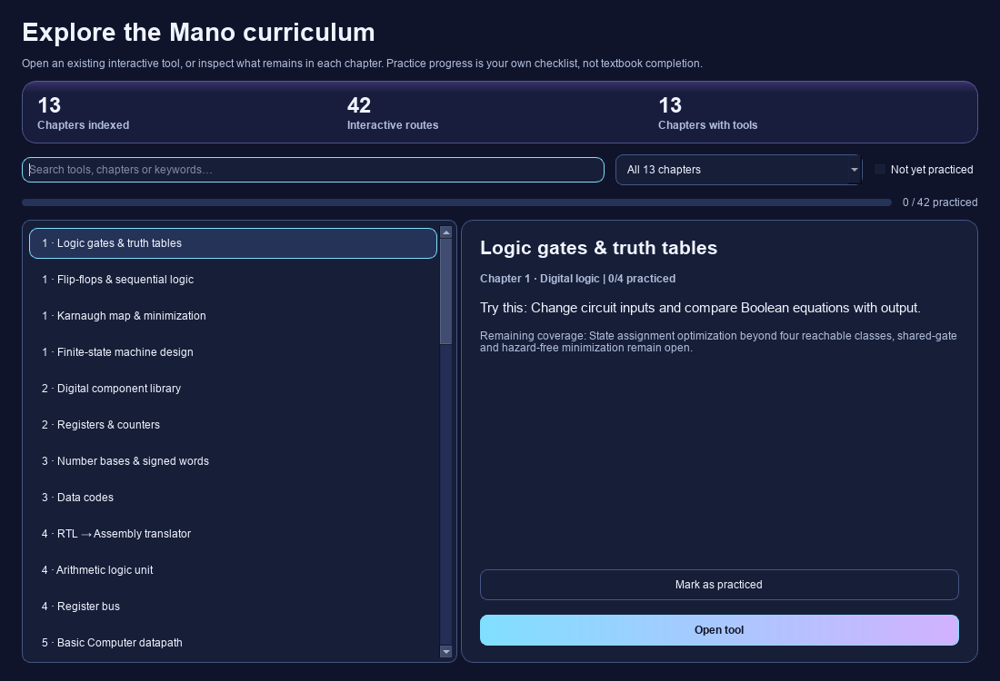</a>
<br><strong>05 · Learning Center</strong><br>
<sub>Find hands-on activities and record practice progress locally.</sub>
</td>
<td valign="top">
<a href="docs/assets/screenshots/live.png">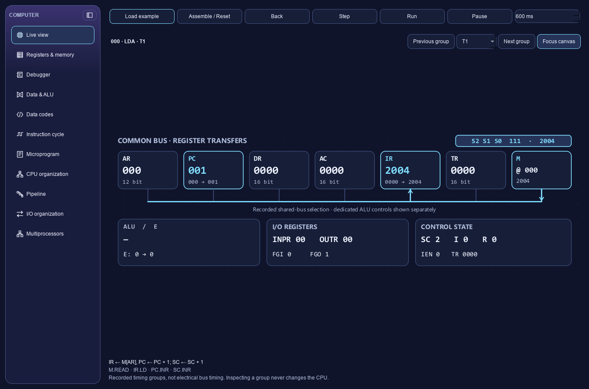</a>
<br><strong>06 · Live computer view</strong><br>
<sub>Follow register transfers and the machine's control state.</sub>
</td>
</tr>
</table>

All six workspace images are actual captures from the tested **Stable 1.0.0 candidate**, not concept art.

## A workspace that adapts

The Mano Glass interface combines a restrained glass-inspired visual identity with readable editors, dedicated workspaces and locally stored preferences. Choose Light, Dark or Night, disable decorative effects, or reduce motion.

English and Persian are built into the interface, including right-to-left layout. Core application functions work offline; an explicit update check is the only planned network-facing product interaction in the current candidate.

<div align="center">
<a href="docs/assets/screenshots/persian.png">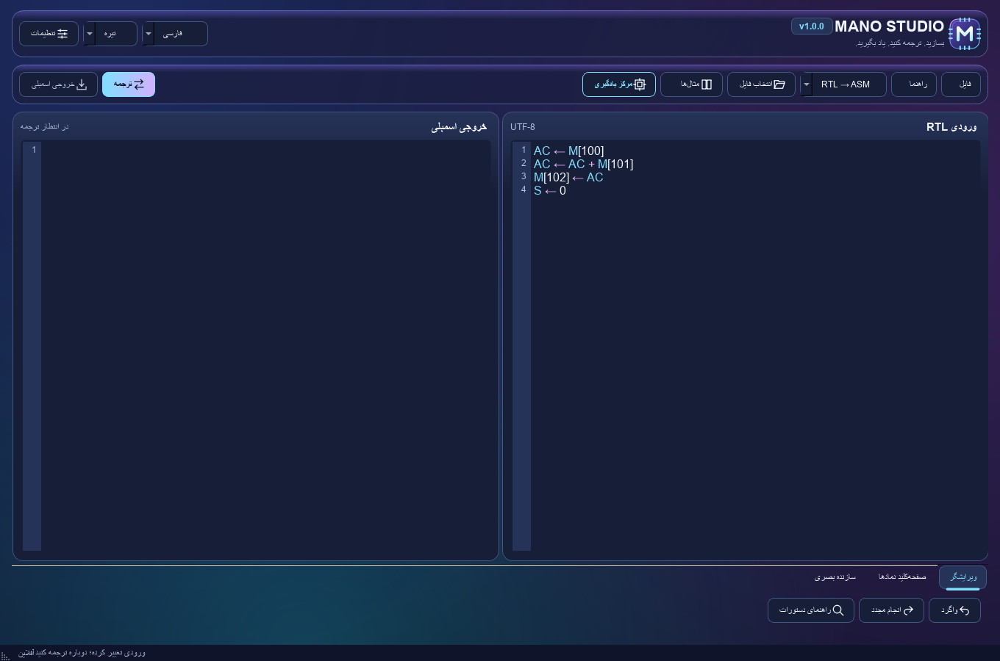</a>
<br><sub>Persian interface · Stable 1.0.0 candidate · RTL layout</sub>
</div>

## Looking ahead — Beta

The forward Beta line is developed independently so new teaching tools do not delay Stable acceptance.

<table>
<tr>
<td width="50%" valign="top">
<a href="docs/assets/screenshots/timing.png">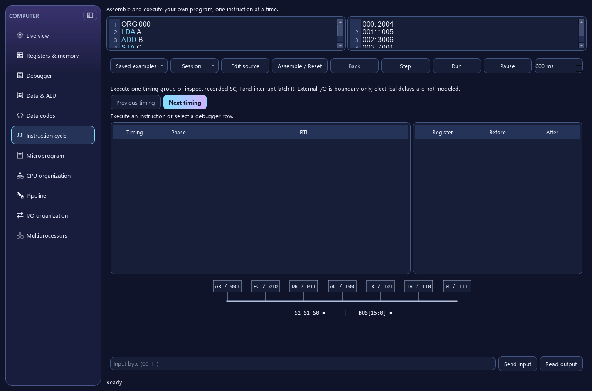</a>
<br><strong>Instruction timing inspector</strong><br>
<sub>Inspect timing groups and register changes across a CPU instruction.</sub>
</td>
<td width="50%" valign="top">
<a href="docs/assets/screenshots/omega.png">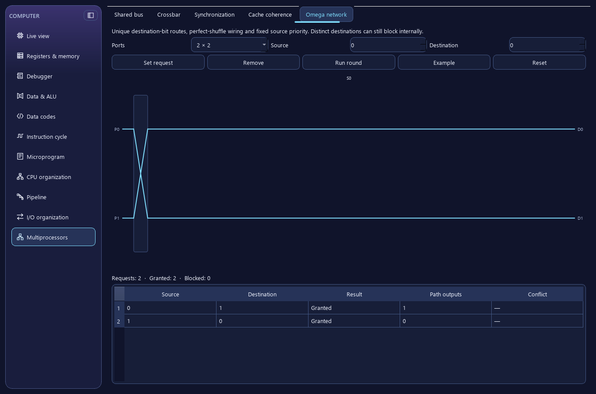</a>
<br><strong>Interconnection networks</strong><br>
<sub>Explore switching paths through an Omega network model.</sub>
</td>
</tr>
</table>

These images come from the tested **1.1.0-beta.1 candidate**. Beta is not a guarantee of complete textbook coverage.

<details>
<summary>Screenshot provenance and additional previews</summary>

All ten PNG files are original Windows offscreen Qt captures. Their exact SHA-256 hashes, source revisions and artifact identities are recorded in [the screenshot provenance manifest](docs/assets/screenshots/provenance.json).

- [Stable regression and desktop capture run](https://github.com/mohammadrezamie/mano-studio/actions/runs/45961164536)
- [Beta parallel regression and visual run](https://github.com/mohammadrezamie/mano-studio/actions/runs/46000977462)
- [Screenshot import verification](https://github.com/mohammadrezamie/mano-studio/actions/runs/46003825766)

Offscreen CI screenshots demonstrate the captured interface, not independent native Windows usability acceptance.

</details>

## Academic core

**One standalone file. No GUI dependencies.**

The assignment's RTL-to-assembly converter is implemented in [`rtl_translator.py`](rtl_translator.py). It uses only the Python standard library, supports the 25 named Basic Computer instructions in the documented provisional dialect, and can be run independently of the desktop application.

```sh
python rtl_translator.py examples/add.rtl -o result.asm
```

The desktop editor invokes the same translator; the optional simulation and learning tools remain separate.

[Download the Python source](https://raw.githubusercontent.com/mohammadrezamie/mano-studio/main/rtl_translator.py) · [RTL dialect](docs/RTL.md) · [Translator guide](docs/TRANSLATOR.md) · [Example input](examples/add.rtl)

## Quick start

For a source development preview, use a compatible Python 3.12 environment:

```sh
git clone https://github.com/mohammadrezamie/mano-studio.git
cd mano-studio
python -m venv .venv
```

Activate the environment on Windows PowerShell:

```powershell
.\.venv\Scripts\Activate.ps1
```

Install the dependencies and start the application:

```sh
python -m pip install -r requirements.txt
python main.py
```

Choose your language, enter supported RTL, translate, and export the result. Press **Ctrl+K** to open the Learning Center.

For local regression checks:

```sh
python -m pip install -r requirements-dev.txt
python -m pytest -q
```

For a packaged Windows installation, see the [download table](#download-table). Setup includes the application-private runtime; installing Python or Qt separately is not required.

## Architecture

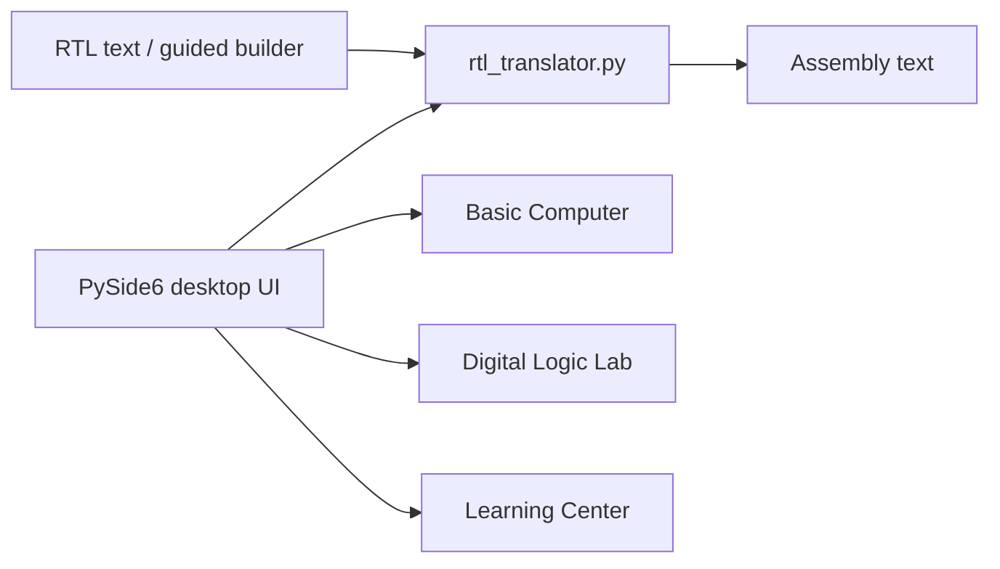

The dependency-free academic core is kept separate from the desktop shell and educational models. User preferences and core learning workflows remain local.

[Technology decisions](docs/TECH_STACK.md) · [Maintainability](docs/MAINTAINABILITY.md)

## Release status

Two independent release tracks, one application. Stable focuses on reliability and Beta advances the educational features.

| Channel | Version | Previous frozen-candidate regression | Current replacement verification |
| --- | --- | --- | --- |
| Stable candidate | `1.0.0` | [1,578 passed per OS](https://github.com/mohammadrezamie/mano-studio/actions/runs/46102530937) | [PR #70](https://github.com/mohammadrezamie/mano-studio/pull/70) · [run 46110089096](https://github.com/mohammadrezamie/mano-studio/actions/runs/46110089096): Ubuntu passed; Windows queued at last check |
| Beta candidate | `1.1.0-beta.1` | [2,302 passed per OS](https://github.com/mohammadrezamie/mano-studio/actions/runs/46102530937) | [PR #71](https://github.com/mohammadrezamie/mano-studio/pull/71) · [run 46110092703](https://github.com/mohammadrezamie/mano-studio/actions/runs/46110092703): Ubuntu running; Windows queued at last check |

The [44-job exact-candidate regression](https://github.com/mohammadrezamie/mano-studio/actions/runs/46048466661), [7,760-execution reconciliation](https://github.com/mohammadrezamie/mano-studio/actions/runs/46102530937), and [signed post-build verification](https://github.com/mohammadrezamie/mano-studio/actions/runs/46050465305) apply to the **earlier frozen source revisions** (Stable `926272ff`, Beta `2dd55994`). They do not transfer automatically to the current notice-corrected PR #70/#71 source revisions. The replacement workflows must pass both operating systems and their dependent Windows Portable/Setup build, smoke, install/uninstall, exact hashes and candidate manifest before the private drafts can be refreshed. Neither release is public.

The frozen candidates bundle OpenSSL 3.5.9, which remains within the upstream affected version range for November 2026 advisories. OpenSSL 3.5.10 is scheduled for 1 December 2026 and is not yet available as of this review. Qt/PySide corresponding-source and relink obligations, complete redistribution review, and independent native Windows acceptance remain open. The installers are not Authenticode-signed; automated in-app installation remains disabled until trusted publisher identity and end-to-end upgrade acceptance are available.

Follow [Stable #4](https://github.com/mohammadrezamie/mano-studio/issues/4), [Beta #23](https://github.com/mohammadrezamie/mano-studio/issues/23), [Actions](https://github.com/mohammadrezamie/mano-studio/actions) and [Releases](https://github.com/mohammadrezamie/mano-studio/releases) for live evidence. Next-generation development continues independently on [maintenance/stable-next (1.0.1)](https://github.com/mohammadrezamie/mano-studio/tree/maintenance/stable-next) and [develop/next-beta (1.1.0-beta.2)](https://github.com/mohammadrezamie/mano-studio/tree/develop/next-beta).

## Documentation

| Getting started | Technical reference |
| --- | --- |
| [Project specification](docs/PROJECT.md) | [RTL dialect](docs/RTL.md) |
| [Status](docs/STATUS.md) | [Computer simulator](docs/SIMULATOR.md) |
| [Roadmap](docs/ROADMAP.md) | [Logic Lab](docs/LOGIC_LAB.md) |
| [Learning Center](docs/LEARNING_CENTER.md) | [Curriculum coverage](docs/CURRICULUM_COVERAGE.md) |
| [Exercises](docs/EXERCISES.md) | [Release policy](docs/RELEASE_POLICY.md) |
| [Design system](docs/DESIGN_SYSTEM.md) | [Brand system](docs/BRAND_SYSTEM.md) |
| [Continuation checkpoint](docs/CONTINUE.md) | [Documentation policy](docs/DOCUMENTATION_POLICY.md) |

Contributors: read [AGENTS.md](AGENTS.md) and [CONTINUE.md](docs/CONTINUE.md). Keep source, documentation and verified release evidence aligned. Do not introduce optional features into a frozen release candidate.

## Acknowledgments and license

An independent educational project for the computer architecture course, inspired by M. Morris Mano's *Computer System Architecture*. Academic acknowledgment and institutional details remain subject to verification; no official endorsement is implied.

Mano Studio source is available under the [MIT License](LICENSE). Third-party components retain their own licenses. See [technical references](docs/REFERENCES.md).
